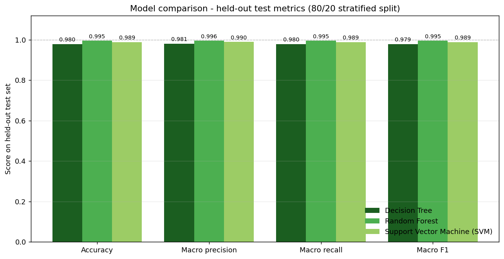

# Crop Recommendation System Using Machine Learning

A complete, reproducible machine learning web application that recommends a suitable crop from seven soil and environmental measurements. Trained on a real public agricultural dataset, evaluated honestly on a held-out test set, and served through a Flask API with a modern agricultural dashboard.



## Table of contents

- [What it does](#what-it-does)
- [Screenshots and generated reports](#screenshots-and-generated-reports)
- [Technology stack](#technology-stack)
- [Project structure](#project-structure)
- [Quick start (Windows)](#quick-start-windows)
- [Dataset](#dataset)
- [Machine learning results](#machine-learning-results)
- [API reference](#api-reference)
- [Dashboard pages](#dashboard-pages)
- [Testing](#testing)
- [Documentation](#documentation)
- [Limitations](#limitations)
- [Attribution and licence](#attribution-and-licence)

## What it does

1. User enters **N, P, K, temperature, humidity, soil pH and rainfall** in the dashboard
2. Browser validates values and sends JSON to Flask backend
3. Backend validates again, passes 7 values in training order to saved scikit-learn pipeline
4. Trained model returns one crop label from **22 crops** with top-3 scores and range warnings
5. Result card shows crop, algorithm used, submitted values, and disclaimer

Three algorithms compared: **Decision Tree, Random Forest, Support Vector Machine**. Best by held-out macro F1 is deployed.

## Screenshots and generated reports

All images generated by the real training pipeline (`python src/train.py`):

| File | What it shows |
| --- | --- |
| [`reports/model_comparison.png`](reports/model_comparison.png) | Held-out metrics for all 3 models |
| [`reports/confusion_matrix.png`](reports/confusion_matrix.png) | Confusion matrix of selected model (Random Forest) |
| [`reports/confusion_matrix_decision_tree.png`](reports/confusion_matrix_decision_tree.png) | DT confusion matrix |
| [`reports/confusion_matrix_random_forest.png`](reports/confusion_matrix_random_forest.png) | RF confusion matrix |
| [`reports/confusion_matrix_svm.png`](reports/confusion_matrix_svm.png) | SVM confusion matrix |
| [`reports/feature_importance.png`](reports/feature_importance.png) | RF feature importances |
| [`reports/dataset_overview.png`](reports/dataset_overview.png) | Class distribution & histograms |
| [`reports/metrics.json`](reports/metrics.json) | Machine-readable metrics/config/hash |
| [`reports/classification_report.txt`](reports/classification_report.txt) | Full per-class reports |

**Dashboard pages:** Overview (`/`), Crop Recommendation (`/recommend`), Model Performance (`/performance`), Dataset Insights (`/dataset`), Documentation (`/docs`), About (`/about`)

## Technology stack

| Layer | Technology |
| --- | --- |
| Language | Python 3.12.10 |
| Data | pandas 2.2.2, NumPy 1.26.4 |
| ML | scikit-learn 1.5.1 (DT, RF, SVC + StandardScaler) |
| Model persistence | joblib 1.4.2 |
| Backend | Flask 3.0.3, JSON REST API |
| Frontend | HTML5, custom CSS3, vanilla JS, Chart.js (CDN) |
| Reports | matplotlib 3.9.2 |
| Testing | pytest 8.3.3 |

## Project structure

```
├── app.py                        Flask app + API
├── requirements.txt              Pinned deps
├── README.md                     GitHub quick start (this file)
├── README_PROJECT.md             Detailed explanation
├── .gitignore
├── data/Crop_recommendation.csv   2,200 records, 22 classes
├── models/                       Model artifacts
├── src/                          Core modules (common, validate, train, predict, download, crop_info)
├── templates/                    HTML templates
├── static/                       CSS/JS/images
├── reports/                      Generated metrics & plots
├── docs/                         PRD, dataset card, model card, guides, test report
└── tests/                        82 pytest tests
```

## Quick start (Windows)

```powershell
# 1. Create venv
python -m venv .venv
.\.venv\Scripts\activate

# 2. Install deps
pip install -r requirements.txt

# 3. Get dataset (skip if exists)
python src\download_dataset.py

# 4. Train & generate artifacts
python src\train.py

# 5. Run app
python app.py
```

Open http://127.0.0.1:5000

**Run tests:** `pytest -q`

## Dataset

- **Source:** Kaggle Crop Recommendation Dataset by Atharva Ingle
- **Records:** 2,200 | **Features:** 7 | **Classes:** 22 (100 each)
- **Missing:** 0 | **Duplicates:** 0
- **SHA-256:** `808e1d84a544647f1ab2fdae04f434b1842692d6be09eee18a5c2d43eb78d77c`
- **Units:** N/P/K ratio, temp °C, humidity %, pH 0-14, rainfall mm (period undocumented)

## Machine learning results

**Split:** 1760 train / 440 test (stratified, seed=42). Tuned via 5-fold stratified CV on training only (scoring f1_macro). Selected by highest held-out macro F1.

| Algorithm | Test accuracy | Macro precision | Macro recall | Macro F1 | CV macro F1 |
| --- | --- | --- | --- | --- | --- |
| Decision Tree | 0.9795 | 0.9806 | 0.9795 | 0.9794 | 0.9858 ± 0.0051 |
| **Random Forest (deployed)** | **0.9955** | **0.9957** | **0.9955** | **0.9955** | 0.9943 ± 0.0048 |
| SVM (linear, C=10) | 0.9886 | 0.9897 | 0.9886 | 0.9886 | 0.9857 ± 0.0018 |

**Errors (RF):** 2/440 (rice→jute, blackgram→maize)

## API reference

| Endpoint | Method | Purpose | Codes |
| --- | --- | --- | --- |
| `/api/health` | GET | Readiness status | - |
| `/api/summary` | GET | Headline stats | - |
| `/api/dataset-insights` | GET | Dataset profile | 503 if missing |
| `/api/model-metrics` | GET | Measured metrics | 503 if not trained |
| `/api/predict` | POST | Predict crop | 400 invalid, 503 missing model |
| `/reports/<file>.png` | GET | Whitelisted reports | 404 |

**Example:**
```powershell
curl -X POST http://127.0.0.1:5000/api/predict -H "Content-Type: application/json" -d "{\"N\":90,\"P\":42,\"K\":43,\"temperature\":25,\"humidity\":80,\"ph\":6.5,\"rainfall\":200}"
```

## Dashboard pages

- **Overview** – Status, metrics, class distribution
- **Crop Recommendation** – 7-field form with validation, example values, results
- **Model Performance** – Comparison, charts, confusion matrices, feature importance
- **Dataset Insights** – Stats, distributions, histograms
- **Documentation** – Links to docs
- **About Project** – Purpose, tech, responsible use

## Testing

```powershell
pytest -q
```
**Result:** 82 passed, 0 failed, 0 skipped (37 validation + 26 routes + 19 prediction)

## Documentation

| Document | Description |
| --- | --- |
| [`README_PROJECT.md`](README_PROJECT.md) | **Detailed explanation**: algorithms, architecture, training, how everything works |
| [`docs/PRD.md`](docs/PRD.md) | Requirements & implementation decisions |
| [`docs/DATASET.md`](docs/DATASET.md) | Data card with verification & stats |
| [`docs/MODEL_CARD.md`](docs/MODEL_CARD.md) | Models, tuning, metrics, intended use |
| [`docs/USER_GUIDE.md`](docs/USER_GUIDE.md) | Step-by-step usage guide |
| [`docs/TECHNICAL_DOCUMENTATION.md`](docs/TECHNICAL_DOCUMENTATION.md) | Architecture, modules, API, implementation details |
| [`docs/TEST_REPORT.md`](docs/TEST_REPORT.md) | Test results & fixes |

## Limitations

- No location/season/soil texture data → limited regional generalization
- Balanced dataset (100 each) → optimistic vs real-world imbalance
- Rainfall period undocumented
- Probabilities not calibrated to real success rates
- Educational decision support only - not for prescriptive agronomic advice

## Attribution and licence

- **Dataset:** Crop Recommendation Dataset by Atharva Ingle (Kaggle)
- **Icons:** Lucide-style SVG (ISC)
- **Charts:** Chart.js (MIT)
- **Crop notes:** Public agronomy references (context only, not used by model)

**Intended use:** Educational and demonstration purposes only.